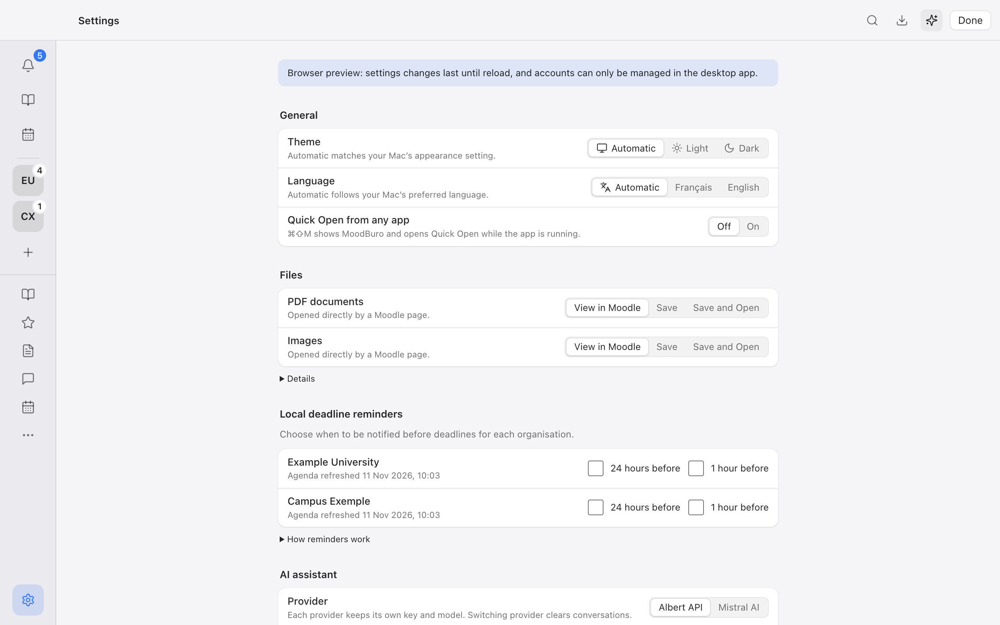
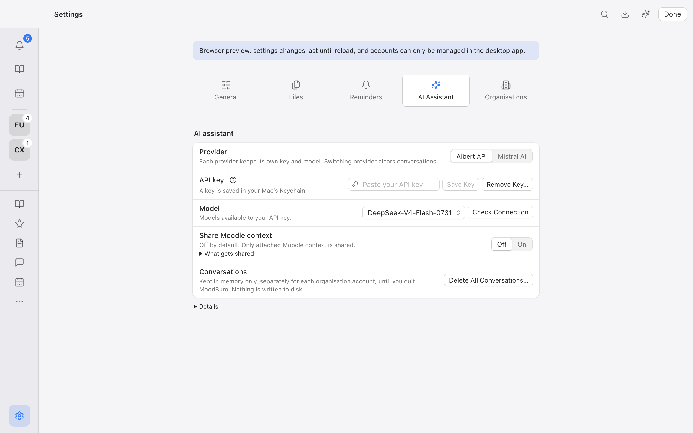
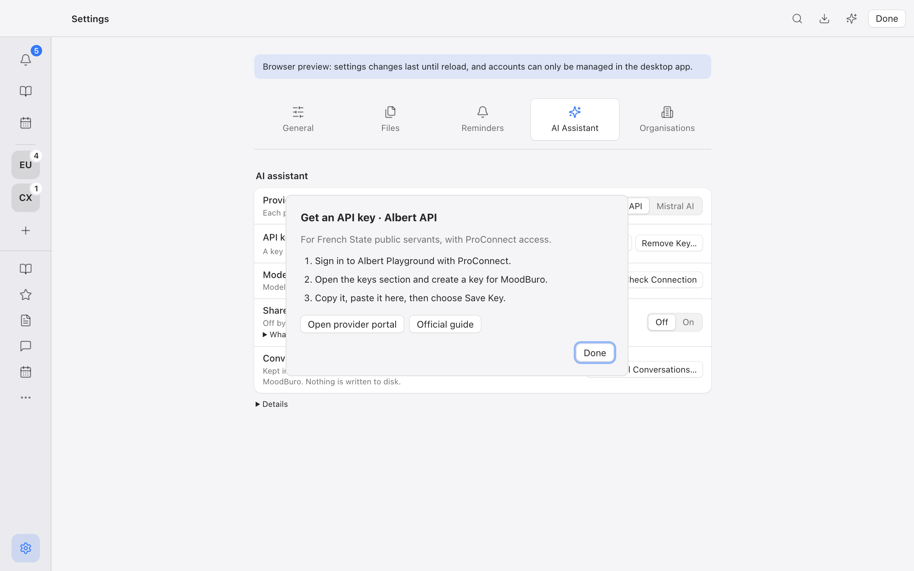

# Settings review — B3

Scope: existing MoodBuro Settings, refined during B3 on 11 November 2026. Existing Mac tokens, controls and icon conventions were retained. This is a local browser/demo review, not installed-app or VoiceOver certification.

| Step | Task and observed health | Evidence |
| --- | --- | --- |
| 1 | Find an option. The original long page placed AI and organisation options below the first viewport. Five icon categories now keep one panel visible; the selected category has a quiet bezel. Healthy at the inspected full width. | Before and categories below |
| 2 | Configure the assistant. Models load automatically from the selected provider's list; switching provider resets the choices. Advanced sharing information is collapsed. Healthy in demo; real key permissions remain provider-dependent. | Categories below; model-list contract/UI tests |
| 3 | Obtain a key. The help icon beside API key opens three provider-specific steps and fixed portal/guide links. Done starts focused; Escape returns to the trigger without leaving Settings. Healthy in browser interaction checks. | Help below |
| 4 | Configure reminders. Connected organisations show both reminder choices. With no organisation, an Add Organisation action replaces the formerly blank tab. Healthy in fixtures and demo. | Frontend empty-state and reminder-row tests; browser DOM |
| 5 | Use a narrow window. FR/dark at 700px and assistant-open geometry were exercised without document overflow. Category wrapping and native selects preserve controls. Screenshot capture timed out after resize, so visual acceptance at narrow sizes remains open. | DOM/interaction evidence only |

## Before

## Categories and compact help

## API-key help

Keyboard checks: category arrow/Home/End handlers and roving tab order, modal focus/Escape restoration, Cancel-first upload review and Escape dismissal. Browser checks covered Albert/Mistral help and model switching in English/French. Screenshots alone do not establish screen-reader behavior or contrast compliance; native VoiceOver, Increase Contrast and installed-app checks remain open.

The screenshots are saved from the actual browser flow and were visually inspected before inclusion. No provider key was entered or generated during this review. Official help references and B3 scope are in [B3 QA](b3-qa.md).
